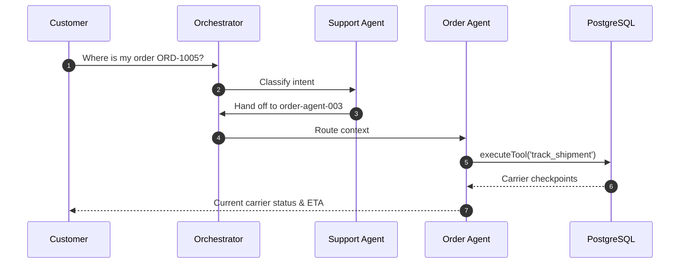

# AI Agent Architecture & Multi-Agent Swarm Design

**System:** `signet-customer-support-lab`  
**Engine:** Node.js v24+ Agent Orchestrator  
**LLM Foundation:** Ollama `beam:cloud`  
**Governance:** Signet Cryptographic Policy Enforcement  

---

## 1. Agent Personas & Risk Tiers

```mermaid
graph LR
    User([Customer]) --> Orchestrator{Agent Orchestrator}
    Orchestrator -->|General Queries / FAQs| Agent1[support-agent-001<br/>Risk: T3 | Semi-Autonomous]
    Orchestrator -->|Returns / Eligibility| Agent2[refund-agent-002<br/>Risk: T2 | Supervised]
    Orchestrator -->|Tracking / Shipping| Agent3[order-agent-003<br/>Risk: T2 | Semi-Autonomous]
    Orchestrator -->|Disputes / Incidents| Agent4[escalation-agent-004<br/>Risk: T2 | Supervised]
```

### Agent 1: Customer Support Assistant (`support-agent-001`)
- **Risk Tier:** T3 | **Autonomy Level:** Semi-Autonomous
- **Mission:** Acts as the conversational frontline. Answers general inquiries, searches store policy, looks up order summaries, and opens initial tickets.
- **Permitted Tools:**
  - `get_customer_profile`: Access customer tier, contact details, and address history.
  - `get_order_status`: Retrieve high-level summary and shipment status for orders.
  - `search_knowledge_base`: Semantic and keyword search across published articles.
  - `create_support_ticket`: Open formal dispute tickets in PostgreSQL.
- **Forbidden:** Processing refunds, cancelling orders, modifying payments, or accessing cross-customer records.

### Agent 2: Refund Specialist (`refund-agent-002`)
- **Risk Tier:** T2 | **Autonomy Level:** Supervised (Human-in-the-Loop)
- **Mission:** Evaluates returns, calculates deductible restocking fees, checks payment status, and issues simulated refunds.
- **Test Policies Enforced:**
  - Refunds > INR 2,000 require supervisor approval signature before release.
  - Refunds > INR 10,000 require supervisor and security dual authorization.
  - Returns requested > 30 days after order placement are rejected.
  - Duplicate refund requests for the same order are blocked atomically.
- **Permitted Tools:** `get_payment_status`, `check_refund_eligibility`, `calculate_refund`, `create_refund_request`, `execute_approved_refund`.

### Agent 3: Order Management Assistant (`order-agent-003`)
- **Risk Tier:** T2 | **Autonomy Level:** Semi-Autonomous
- **Mission:** Provides comprehensive carrier tracking timelines, coordinates delivery address updates, and requests cancellations for unfulfilled orders.
- **Permitted Tools:** `get_order_details`, `track_shipment`, `request_order_cancellation`, `update_delivery_preference`.
- **Forbidden:** Modifying financial amounts, cancelling orders already marked `DELIVERED` or `OUT_FOR_DELIVERY`.

### Agent 4: Escalation Coordinator (`escalation-agent-004`)
- **Risk Tier:** T2 | **Autonomy Level:** Supervised
- **Mission:** Analyzes unresolved disputes, detects prompt injection/jailbreak attempts, files formal security incidents, and routes urgent cases to human supervisors.
- **Permitted Tools:** `create_escalation`, `create_security_incident`, `request_supervisor_review`, `get_ticket_history`.

---

## 2. Multi-Agent Workflows

### Workflow A: Order Lookup & Tracking Handoff


### Workflow B: Defective Product Return & Approval
1. Customer requests a return: *"My headphones arrived cracked. I want a refund."*
2. Support Agent hands off to **Refund Specialist** (`refund-agent-002`).
3. Refund Agent executes `check_refund_eligibility` verifying the 30-day window and completed payments.
4. If amount > INR 2,000, status transitions to `PENDING` supervisor authorization.
5. Supervisor reviews on the Approvals Queue (`/approvals`) and approves.
6. Refund Agent issues simulated transaction disbursement reference.

### Workflow C: Dispute Escalation
1. Customer expresses severe frustration: *"I need to speak to a manager immediately."*
2. Support Agent delegates to **Escalation Coordinator** (`escalation-agent-004`).
3. Escalation Agent executes `create_escalation`, marking the ticket `URGENT` in PostgreSQL and notifying supervisors.
