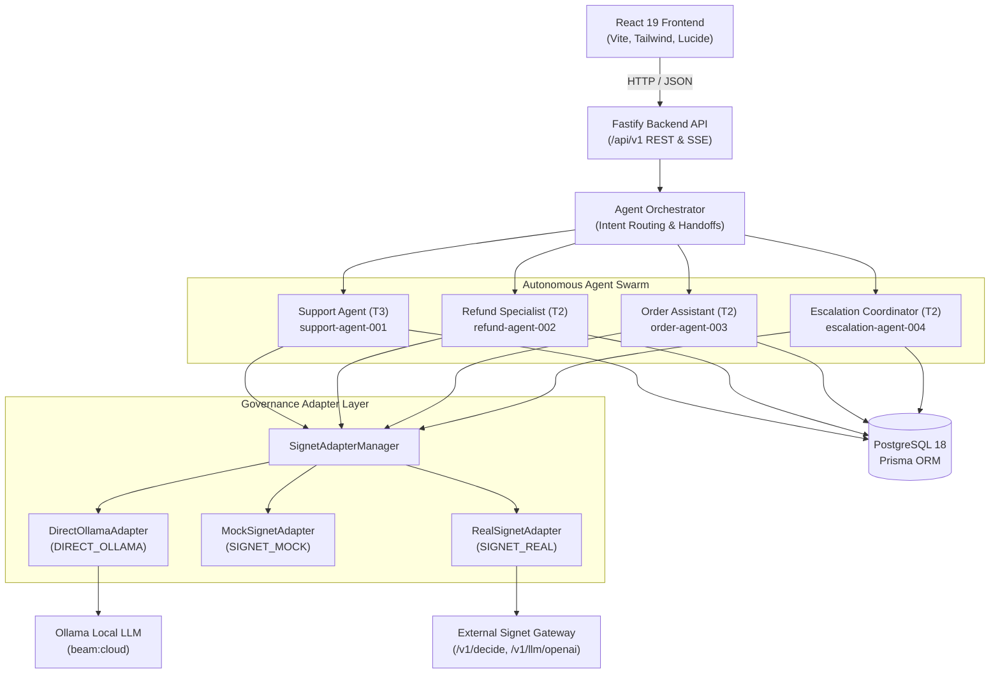

# System Architecture & Technical Specification

**Project:** `signet-customer-support-lab`  
**Stack:** Node.js v24+, React 19, TypeScript, PostgreSQL 18+, Ollama (`beam:cloud`), Signet AI Governance  
**Pattern:** Monorepo (`npm workspaces`), Layered Multi-Agent Swarm, Fail-Closed Security Gateway  

---

## 1. System Overview

The Signet Customer Support AI Agent Lab is a full-stack, enterprise-grade multi-agent customer support platform built to operate in two distinct modes:
1. **Standalone Autonomous Mode (`DIRECT_OLLAMA`):** The four autonomous AI agents run directly against a local Ollama LLM (`beam:cloud`) and PostgreSQL database with in-process role-based permissions and strict customer data isolation.
2. **Signet Governed Mode (`SIGNET_MOCK` / `SIGNET_REAL`):** All agent model requests, tool calls, and agent-to-agent handoffs route through a cryptographic AI governance adapter that enforces mTLS certificates, workload identity tokens, real-time Data Loss Prevention (DLP), human-in-the-loop approvals, and emergency kill switches.



---

## 2. Monorepo Structure

```
signet-customer-support-lab/
├── apps/
│   ├── backend/               # Fastify API, authentication, error handler, routes
│   └── frontend/              # React 19 SPA, Tailwind CSS, TanStack Query, Recharts
├── packages/
│   ├── shared/                # Universal TypeScript types, DTOs, Zod schemas
│   ├── database/              # Prisma schema, client instance, seed scripts
│   ├── agents/                # Four AI agents, AgentRunner, AgentOrchestrator, StateManager
│   ├── tools/                 # 17 domain tools validated by Zod schemas
│   └── signet-adapter/        # Signet Gateway client, adapters, scenarios, event collector
├── docs/                      # Architectural, database, test, and troubleshooting documentation
├── tests/                     # Acceptance and governance Vitest test suites
├── prisma/                    # Database schema and migration history
├── docker-compose.yml         # Containerized production stack configuration
└── package.json               # Monorepo workspaces definition
```

---

## 3. Four Autonomous AI Agents

| Agent ID | Persona | Risk Tier | Autonomy | Model | Allowed Tools | Forbidden Actions |
|---|---|---|---|---|---|---|
| `support-agent-001` | Customer Support Assistant | T3 | Semi-Autonomous | `beam:cloud` | `get_customer_profile`, `get_order_status`, `search_knowledge_base`, `create_support_ticket` | Issue refunds, modify payments, cancel orders, cross-customer data |
| `refund-agent-002` | Refund Specialist | T2 | Supervised | `beam:cloud` | `get_payment_status`, `check_refund_eligibility`, `calculate_refund`, `create_refund_request`, `execute_approved_refund` | Unlinked order refunds, bypass approval thresholds (>2k INR) |
| `order-agent-003` | Order Management Assistant | T2 | Semi-Autonomous | `beam:cloud` | `get_order_details`, `track_shipment`, `request_order_cancellation`, `update_delivery_preference` | Modify payments, cancel fulfilled shipments, delete orders |
| `escalation-agent-004` | Escalation Coordinator | T2 | Supervised | `beam:cloud` | `create_escalation`, `create_security_incident`, `request_supervisor_review`, `get_ticket_history` | Alter agent security configs, direct database mutation |

---

## 4. Multi-Agent Orchestration & Intent Routing

The `AgentOrchestrator` (`packages/agents/src/orchestrator.ts`) processes incoming customer messages through a three-stage pipeline:
1. **Intent Classification:** Parses user message for keywords (refund, cancel, supervisor, order tracking) or delegates to LLM intent resolution.
2. **Contextual Handoffs:** Supports dynamic agent-to-agent delegation (Workflows A, B, and C) with strict loop prevention (maximum delegation depth = 4 hops).
3. **Execution Persistence:** Logs every conversation turn, handoff, tool invocation, and governance decision into PostgreSQL.

---

## 5. Dual-Mode Governance Architecture

### Mode 1: DIRECT_OLLAMA
- Bypasses external gateway overhead.
- Used as a benchmark baseline.
- Internal Fastify and Zod validation enforce application-level role boundaries.

### Mode 2: SIGNET_REAL
- Traffic routes via `SignetGatewayClient` with workload identity headers:
  - `x-signet-agent-cert`: Cryptographic certificate identifier
  - `x-signet-workload-id`: SPIFFE identity URI
  - `x-signet-tenant-id`: Tenant isolation key
- **Fail-Closed Semantics:** If the Signet Gateway returns HTTP 500, 502, 503, 504 or times out, the application aborts the request immediately. **Under no circumstances does it silently fall back to direct Ollama.**
